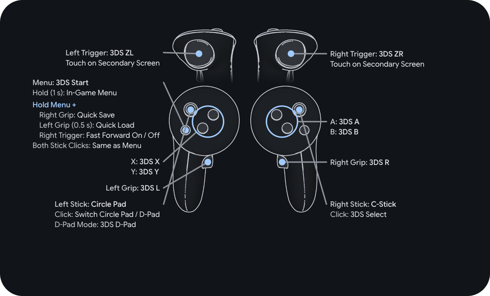
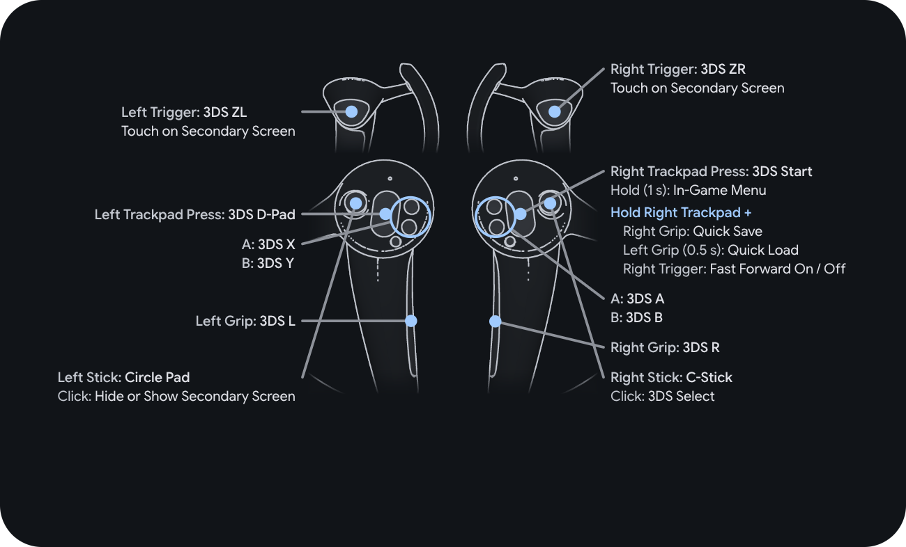
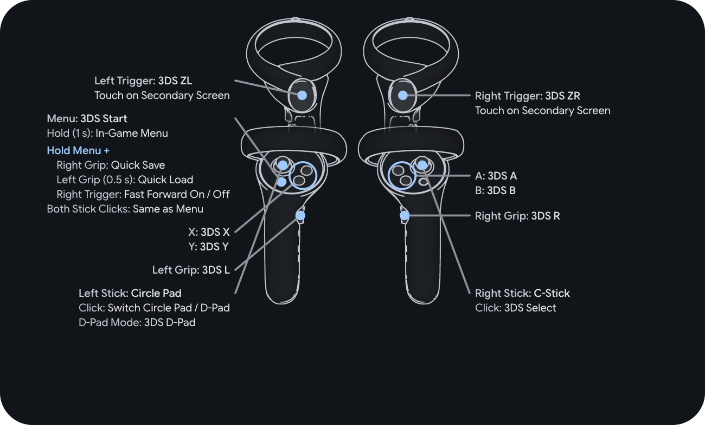

# Azahar VR

3DS, DS, GBA and GB/GBC games in VR: standalone on the Valve Steam Frame, and in PC VR (Windows and Linux x86-64) through OpenXR.
It is my unofficial fork of [Azahar](https://github.com/azahar-emu/azahar), with the VR modes of amwatson's [CitraVR](https://github.com/amwatson/CitraVR). DS games run on [melonDS](https://github.com/melonDS-emu/melonDS), GBA and GB/GBC games on [mGBA](https://github.com/mgba-emu/mgba).
On the Steam Frame it is called **Azahar for Frame**.


## Features

- Stereoscopic 3D at 90 or 120 Hz, with a touch Secondary Screen
- 3DS, DS, GBA and GB/GBC games in one games list
- **Layer Depth** (Experimental): 3D depth for DS, GBA and GB/GBC games
- A second screen for GBA games, from [gba-ds](https://github.com/kyannon/gba-ds) and [PokeDaisy](https://gitlab.com/pokedaisy/pokedaisy)
- Switch between VR and Flat mid-game
- Immersive Mode with Natural 3D, matched to your IPD
- A redesigned VR menu with save states and autosave, for every console
- In-app cheat, mod, texture pack and homebrew downloader
- Angel's Aim: a 6DoF mod for Kid Icarus: Uprising with hand tracking, Direct Aim and a redesigned single-screen HUD
- Edit the controls of any gamepad or mouse

## 3D and immersion

- **VR or Flat, any time**: press both bumpers, **View** and **Menu** together.
- **Immersive Mode**: the game draws a wider view, from a big screen fixed in the room to a camera that moves with your head.
- **Natural 3D**: the game is drawn true to scale, from your IPD as the headset measures it. At 100% **3D Depth**, distant scenery sits at essentially infinity.
- **World Scale**: how big the game world feels, from 10% to 400%.
- **Immersive presets**: The Legend of Zelda: Ocarina of Time 3D, Majora's Mask 3D, Super Mario 3D Land and Mario Kart 7 start with settings tuned for VR.

## DS, GBA and GB/GBC

Add a folder with `.nds`, `.gba`, `.gb` or `.gbc` files (or zips of them) to the games list, as for 3DS games. A **System** column and filter chips sort them out, and the VR menu has a **Games** tab. No BIOS files are needed.

- **DS**: melonDS with its JIT, with **Internal Resolution** and **Dynamic Resolution**. The microphone works, **Microphone Blow** is a button you can map, and **Close Lid** is in the VR menu.
- **GBA and GB/GBC**: the mGBA core, with an optional **Texture Filter**. **X** and **Y** are Auto Fire A and Auto Fire B.
- **Layer Depth** (Experimental): the game's layers, or a DS game's 3D scene, spread out in depth for each eye. Set it per game.
- **Second Screen**: GBA games that gba-ds supports get a Secondary Screen of their own, and Pokémon games get PokeDaisy's companion pages. If a game supports both, you can choose either.
- **DS widescreen hacks**: TWiLight Menu++'s widescreen hacks install from the **Mods** tab.
- **Saves**: one folder per game for saves, save states and cheats. Save states, autosave, **Undo Load** and **Load Anyway** work as for 3DS games.
- **Cheats**: downloaded from [libretro-database](https://github.com/libretro/libretro-database) and my [ds-gba-game-fixes](https://github.com/simplysanatori/ds-gba-game-fixes).
- **Covers**: **Download Game Covers** for the VR **Games** tab. It is off by default; Azahar VR asks once when new games are added.

## The VR menu

Hold **Menu** for 1 second to open the VR menu. It supports global and per-game settings, and each console keeps its own **Internal Resolution**, **Texture Filter**, **Layer Depth** and screen positions.

It has an in-app cheat, mod and texture pack downloader:

- **Cheats**: from the [Sharkive](https://github.com/FlagBrew/Sharkive) 3DS database, libretro-database for DS, GBA and GB/GBC, and fixes I made in [3ds-game-fixes](https://github.com/simplysanatori/3ds-game-fixes) and [ds-gba-game-fixes](https://github.com/simplysanatori/ds-gba-game-fixes)
- **Mods** and **texture packs**: a curated list of creators' own uploads on GameBanana, GitHub, MEGA and Google Drive. Downloaded packs show **Update Available** when their creator updates them, and **Delete** removes a pack you no longer want.

  

Nothing is hosted by this project. The app only fetches files from their original sources, and each entry links to its creator's page.

A **Verified** chip marks entries known to work in Azahar VR. A check-mark badge marks the recommended cheat, mod or texture pack for a game.

## Homebrew and mod packs

- **Homebrew** (beta): the first entry is [Emerald 3DS](https://github.com/ZallaxDev/emerald-3ds) by ZallaxDev. It downloads from its GitHub and builds from a Pokémon Emerald ROM **dumped from your own cartridge**.
- **CTGP-7**: with Mario Kart 7 open, the **Mods** tab installs [CTGP-7](https://ctgp-7.github.io/) by PabloMK7 and the CTGP-7 team. It downloads only from the official CTGP-7 page. Nothing of CTGP-7 is included or redistributed.
- **Angel's Aim** (alpha): a Kid Icarus: Uprising mod pack I'm building. More on [its page](https://github.com/simplysanatori/3ds-game-fixes/blob/main/docs/angels-aim.md).
  - Direct Aim support. All 108 weapons are rebuilt as 3D models in your hand, with their effects.
  - First Person and Third Person views, with movable HUD elements from both the top and bottom screens.
  - **60 FPS** (Experimental), for both the European and USA versions: on by default on PC, off on the Steam Frame. On the Frame, keep it off unless you play at 1x or 2x **Internal Resolution**.

## Game-specific fixes

- **Accurate Image Copies** (**Settings** > **Graphics**) fixes the shimmer and glow in the Fire Emblem 3DS games (Echoes, Awakening and Fates) at raised internal resolutions. Its default, **Automatic**, applies it only where a frame needs it.

## Experimental

- **Black Frame Insertion**: a clearer picture when you turn your head (in Immersive Mode especially). It only works at 120 Hz, and may flicker in games with heavier rendering.
- **Detach Screens**: move the Primary and Secondary Screens apart in 3D space. **Screen Gap** sets how far apart linked screens sit.
- **HUD Spacing**: in the Full modes, brings the game's HUD in from the edges of your view.

## Requirements

**Steam Frame**

- SteamOS Stable or Beta
- About 500 MB of free storage

**PC**

- Windows (64-bit), or Linux x86-64 (untested, bug reports welcome)
- An OpenXR runtime, such as SteamVR, and a headset it supports, or a Steam Frame streaming from SteamVR
- A graphics card with Vulkan
- On Windows, [7-Zip](https://www.7-zip.org) for some mod archives

**Everywhere**: your own games, dumped from your own consoles and cartridges.

## Install on the Steam Frame

1. Get the repository:

   ```sh
   git clone -b steam-frame https://github.com/simplysanatori/AzaharVR.git
   cd AzaharVR
   ```

2. Download `azaharframe-<version>-linux-arm64.tar.gz` from [Releases](https://github.com/simplysanatori/AzaharVR/releases) and install it:

   ```sh
   steam-frame/install.sh ~/Downloads/azaharframe-<version>-linux-arm64.tar.gz
   ```

3. Launch **Azahar for Frame** from your Steam library.

Other installers:

- [Frametanium](https://github.com/Cogential/frametanium): add `simplysanatori/AzaharVR`.
- [FrameDrop](https://framedropvr.com): [Install with FrameDrop](https://framedropvr.com/install?manifest=https%3A%2F%2Fgithub.com%2Fsimplysanatori%2FAzaharVR%2Freleases%2Flatest%2Fdownload%2Fazaharframe.framedrop.json).

To update, quit the emulator and install the new tarball the same way. To uninstall, run `steam-frame/uninstall.sh`; add `--purge` to also delete your settings, saves and keys. Your games are never touched.

Checksums and building: [user guide](docs/USER_GUIDE.md#install-update-and-uninstall).

## Install on a PC

**Windows**

1. Download `azahar-vr-<version>-windows-x86_64.zip` from [Releases](https://github.com/simplysanatori/AzaharVR/releases) and unzip it anywhere.
2. Start SteamVR, then `azahar.exe`.

Started without VR, Azahar VR opens in a window. The **VR** button in the status bar starts it again in your headset, and says why if VR can't start. `azahar.exe --vr` starts straight in VR.

**Linux (x86-64, untested)**

1. Download `azahar-vr-<version>-linux-x86_64.tar.gz` from [Releases](https://github.com/simplysanatori/AzaharVR/releases) and extract it.
2. Start SteamVR, then `azahar-vr/azahar --vr`.

To update, replace the program's files with the new version's. Your settings and saves are kept separately:

| | Settings, saves and keys |
|---|---|
| Windows | `%APPDATA%\AzaharVR` |
| Linux | `~/.local/share/azahar-vr` |
| Windows, portable | a `user` folder beside `azahar.exe`, if you make one |

## First run

1. Double-click the empty game list and select the folder with your games.
2. Double-click a game to start it.

Keys and texture packs: [user guide](docs/USER_GUIDE.md#games).

## Controls


| Steam Frame | What it does |
|---|---|
| **A**, **B**, **X**, **Y** | 3DS B, A, Y, X (by position) |
| Hold **Menu** for 1 second | In-game menu |
| Hold **View** for 1.5 seconds | Stop the game |
| Hold **View**, then right or left bumper | Quick Save or Quick Load |
| Hold **View**, then right trigger | Fast Forward on or off |
| Both bumpers + **View** + **Menu** | Switch between VR and Flat |
| Trigger on the Secondary Screen | Touch |

On a PC, with Meta Quest, Valve Index or Vive XR Elite controllers:

| | Meta Quest, Vive XR Elite | Valve Index |
|---|---|---|
| 3DS A, B, X, Y | **A**, **B**, **X**, **Y** | Right **A**, **B**; left **A** is X, left **B** is Y |
| 3DS L, R / ZL, ZR | Grips / triggers | Grips / triggers |
| Circle Pad / C-Stick | Left stick / right stick | Left stick / right stick |
| D-pad | Left stick, after a left stick click | Left trackpad press |
| Hide or Show Secondary Screen | | Left stick click |
| Select / Start | Right stick click / **Menu** | Right stick click / right trackpad press |
| In-game menu | Hold **Menu** for 1 second (or both stick clicks) | Hold the right trackpad for 1 second |
| Quick Save / Quick Load | Hold **Menu**, then right grip / left grip | Hold the right trackpad, then right / left grip |
| Fast Forward | Hold **Menu**, then right trigger | Hold the right trackpad, then right trigger |
| Touch | Trigger on the Secondary Screen | Trigger on the Secondary Screen |

Move the screens with **Move Screens** on the in-game menu's **Position** tab. **Controllers**, on the **Controls** tab, picks the controllers if Azahar VR guesses wrong.

<details><summary>Meta Quest</summary>


</details>
<details><summary>Valve Index</summary>


</details>
<details><summary>Vive XR Elite</summary>


</details>

To change them, use **Edit Controls** on the in-game menu's **Controls** tab, in its **Buttons**, **Pointing** and **Motion** sections. GBA and GB/GBC games show a Game Boy Advance there. Full list: [docs/CONTROLS.md](docs/CONTROLS.md).

## Troubleshooting

- The installer says Steam was not reachable: start Steam and run `install.sh` again.
- The SteamVR dock shows a question mark: restart Steam once.
- The screens do not appear: start SteamVR first, then Azahar VR.
- An encrypted 3DS game does not start: it needs `aes_keys.txt` in the `sysdata` folder of your settings folder (on the Frame, `~/.local/share/AzaharFrame/user/sysdata/`).
- **Azahar Ran Out of Memory**: turn off **Preload Custom Textures**, or use **Optimize for Frame** on the pack.
- Windows: keep 3DS texture packs and mods in folders whose names use only your Windows language's letters.
- PC, streaming to a Steam Frame: SteamVR uses foveated streaming. If you notice blur, change **Foveated Encoded Video Size** and **Preferred Foveated Sharpness** in SteamVR's **Streaming** settings.

Azahar VR checks GitHub once at start for a newer release, and asks whether to **Open GitHub**.

More: [docs/USER_GUIDE.md](docs/USER_GUIDE.md#troubleshooting).

## Reporting a problem

Use **Report a Problem**: **Settings** > **General** > **Help** in the in-game menu, or **Help** in Azahar's window.
**See What's Sent** shows the whole report. **Save Report** makes a zip to attach to an [issue](https://github.com/simplysanatori/AzaharVR/issues); check it before sharing. **Send Report** sends it to me. Nothing is sent unless you tap it.

## More

- [User guide](docs/USER_GUIDE.md)
- [Settings](docs/SETTINGS.md)
- [AGENTS.md](AGENTS.md): for developers and AI agents
- [Building from source](docs/TECHNICAL_NOTES.md#building)
- [Changelog](docs/CHANGELOG.md)

## Support

If you want to support this app or my other Steam Frame ports, such as PrimedFrame, you can [buy me a coffee](https://ko-fi.com/sana748653).

## Credits

- [Azahar](https://github.com/azahar-emu/azahar), which continues [Citra](https://github.com/citra-emu/citra): the emulator
- [CitraVR](https://github.com/amwatson/CitraVR) by amwatson: the VR modes
- [melonDS](https://github.com/melonDS-emu/melonDS) by the melonDS team: DS and DSi
- [mGBA](https://github.com/mgba-emu/mgba) by Vicki Pfau (endrift) and contributors: Game Boy Advance, Game Boy and Game Boy Color
- [gba-ds](https://github.com/kyannon/gba-ds) by kyannon: the second screen of Game Boy Advance games
- The second screen of Pokémon games: Based on PokeDaisy by Lidor Itzhari - https://github.com/lidor30/pokedaisy (now at https://gitlab.com/pokedaisy/pokedaisy)
- [TWiLight Menu++](https://github.com/DS-Homebrew/TWiLightMenu) by the DS-Homebrew team: the DS widescreen hacks, downloaded from their own source
- [Qt](https://www.qt.io), [SDL](https://www.libsdl.org), [OpenXR](https://www.khronos.org/openxr/): window, gamepad, VR
- [astcenc](https://github.com/ARM-software/astc-encoder) by Arm: the texture pack encoder
- [Frametop](https://github.com/Frametop/frametop) by DeeJanuz: the 3D mouse pointer is adapted from it
- [Sharkive](https://github.com/FlagBrew/Sharkive) by FlagBrew, and my [3ds-game-fixes](https://github.com/simplysanatori/3ds-game-fixes): the cheats
- [libretro-database](https://github.com/libretro/libretro-database) (CC-BY-SA-4.0), and my [ds-gba-game-fixes](https://github.com/simplysanatori/ds-gba-game-fixes): the DS, GBA and GB/GBC cheats
- [Emerald 3DS](https://github.com/ZallaxDev/emerald-3ds) by ZallaxDev, and [CTGP-7](https://ctgp-7.github.io/) by PabloMK7: downloaded from their own sources
- Mods and texture packs: downloaded from their authors' own pages
- Azahar logo by angyartanddraw and PabloMK7; backgrounds by GarfieldGaming0624 on [SteamGridDB](https://www.steamgriddb.com/game/5480678)
- Valve: SteamVR and the Frame

Full list: [THIRD_PARTY_NOTICES.md](THIRD_PARTY_NOTICES.md). Not affiliated with Nintendo or Valve.

## Licence

GPLv3. See [LICENSE.txt](LICENSE.txt).

## How this was made

I started this project and used LLMs (specifically Claude Opus 5.5) to speed up development. I write, review and fix code by hand all the way through, keep the AI's work checked and reined in, and aim to keep the port as lightweight as possible. I test it on my own Steam Frame.
